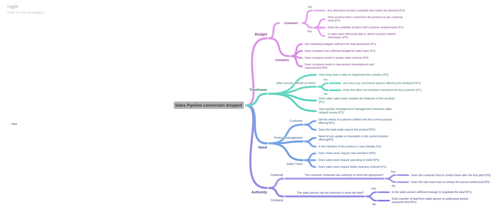
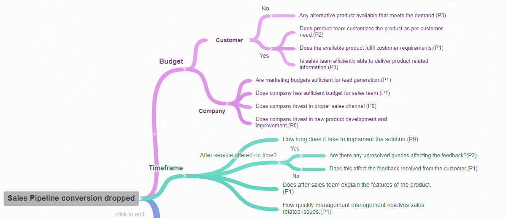
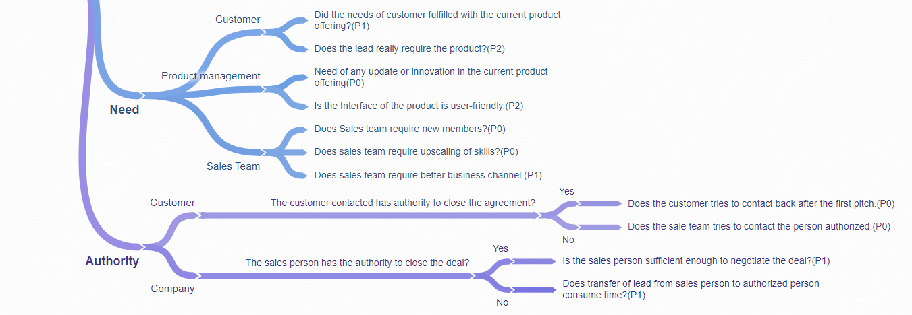

# Business Analyst Project: Sales Pipeline Conversion at a SaaS Startup

**Problem statement:** The sales pipeline conversion percentage at TechnoServe (a tech SaaS startup) has dropped from 35% at the end of last fiscal (FY 2017-18) to 25% at present.

This project frames the problem, builds a hypothesis tree using the BANT framework (Budget, Authority, Need, Timeframe), analyses the provided sales opportunity dataset, and presents insights and recommendations in a slide deck.

## Preview

Hypothesis tree for the drop in pipeline conversion (made with Coggle):



Close-ups of the Budget/Timeframe and Need/Authority branches:




## What's inside

| File | Contents |
| --- | --- |
| `BA_Project_.pptx` | 21-slide presentation (1.8 MB) |
| `Data+Dictionary.pdf` | Column definitions for the TechnoServe sales pipeline dataset |
| `Sales_Pipeline_conversion_dropped.png` | Full BANT hypothesis tree |
| `Capture.PNG`, `Capture1.PNG` | Close-up screenshots of the hypothesis tree |

The sales dataset used for the analysis is not included in the repository.

## Presentation outline

- **Part I - Understanding the problem:** who, what, when, how and where of the conversion drop, and Situation / Problem / Implication / Need-Payoff questions.
- **Part II - Formulating hypotheses:** why BANT was chosen, the hypothesis tree, and prioritised hypothesis branches (P0/P1).
- **Part III A - Generating insights:** analysis by Technology Primary, B2B Sales Medium, Client Revenue Sizing, Opportunity Sizing and Business from Client Last Year, followed by recommendations with their supporting insights.
- **Part III B - Presenting findings.**

## Dataset fields

From the data dictionary: Opportunity ID, Technology Primary, City, B2B Sales Medium, Sales Velocity, Opportunity Status (Won/Lost), Sales Stage Iterations, Opportunity Size (USD), Client Revenue Sizing, Client Employee Sizing, Business from Client Last Year, Compete Intel and Opportunity Sizing.

## Tools used

- Microsoft Excel (charts embedded in the deck)
- Microsoft PowerPoint
- Coggle (hypothesis tree)

## How to open

Open `BA_Project_.pptx` in PowerPoint (or Google Slides / Keynote) and `Data+Dictionary.pdf` in any PDF viewer.

## Repository structure

```text
Business-analyst-Project-I/
├── README.md
├── BA_Project_.pptx
├── Data+Dictionary.pdf
├── Sales_Pipeline_conversion_dropped.png
├── Capture.PNG
└── Capture1.PNG
```
